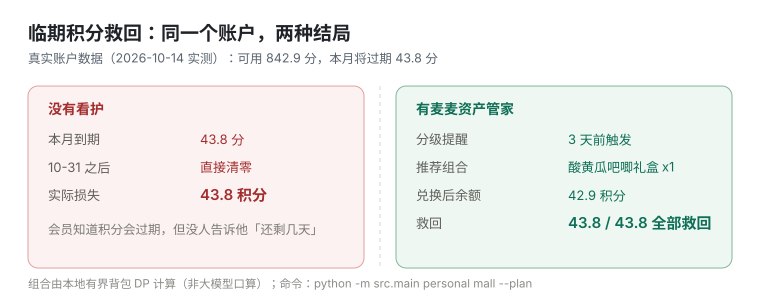
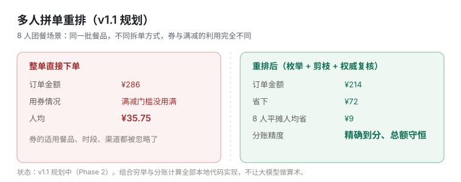

# 麦麦资产管家 · mcd-asset-guard

> **个人资产不蒸发 + 团队消费不虚花**——积分过期前救回来，周边开抢时提醒你，多人拼单时算到最省、分账分到分。

基于麦当劳 MCP Server（`https://mcp.mcd.cn`，Streamable HTTP）构建的确定性资产守护工具。

---

## 目录

- [它解决什么问题](#它解决什么问题)
- [目标用户](#目标用户)
- [效果预览](#效果预览)
- [核心设计：算术交给代码，绝不交给大模型](#核心设计算术交给代码绝不交给大模型)
- [安装](#安装)
- [快速开始：零配置离线演示](#快速开始零配置离线演示)
- [在线模式](#在线模式)
- [命令参考](#命令参考)
- [目录结构](#目录结构)
- [安全设计](#安全设计)
- [真实接口实证](#真实接口实证)
- [路线图](#路线图)
- [免责声明](#免责声明)

---

## 它解决什么问题

麦当劳的会员资产（积分、券、派对名额）有三个**静默流失**的口子：

| 流失口 | 现状 | 本项目的做法 |
|---|---|---|
| **积分过期** | 接口只给"本月将过期多少分"，不给具体到期日；会员往往在被清零后才知道 | 按月推算到期日 → 7/3/1 天分级提醒 → 直接给出"能救回的兑换组合" |
| **兑换窗口错过** | 周边商品有精确到秒的上架/下架窗口，热门款"每日 14:00 准时开抢" | 标记即将下架 / 即将开抢，盯住窗口 |
| **派对空位** | 主题派对有名额限制，热门时段靠刷 | 常驻轮询场次剩余名额，只对**新增/重新开放**的空位告警 |

## 目标用户

- **麦享会会员**：手里有几百到几千积分，但不知道什么时候过期、够换什么；
- **家庭 / 亲子用户**：想约主题派对，需要知道哪家店哪天哪个时段还有名额；
- **团队点餐组织者**（v1.1）：公司团餐、朋友聚会，要在一堆券和满减规则里找到最省的拆单方式，并把账分清楚。

## 效果预览

**① 临期积分救回**（真实账户数据，2026-10-14 实测：可用 842.9 分，本月将过期 43.8 分）



**② 多人拼单重排**（v1.1 规划，Phase 2 实现）



真实的终端输出（可直接复现，见「快速开始」）：

```
== 积分看护 ==
账户:              1D93F1BE-...(已脱敏)
币种:              麦享会积分
可用积分:          842.9
本月将过期:        43.8
下月将过期:        0.0
上月已过期:        0.0
累计已过期:        2409.6
累计获得 / 已使用: 7557.5 / 4305.0

基准日期 2026-10-28（服务端时间或 --as-of 推算）
  本月: 43.8 积分 -> 2026-10-31 到期，剩 3 天 · 高档

!! [high] 本月将过期 43.8 积分：3 天后（2026-10-31）清零
   建议：python -m src.main personal mall --plan  查看可救回的兑换组合
```

```
== 兑换规划（策略 rescue） ==
目标：救回本月临期 43.8 积分

  - 酸黄瓜吧唧礼盒 x1（800.0 积分，¥0.00）
合计消耗:   800.0 积分
救回临期:   43.8 / 43.8
兑换后余额: 42.9 积分

结论：本月临期 43.8 积分已全部救回
```

## 核心设计：算术交给代码，绝不交给大模型

项目的**架构铁律**：

> **取数交给 MCP、算术交给代码、表达交给 Agent。**

主流程里**没有任何一次大模型调用**。排序、组合优化、到期判断、分账、金额换算，全部是本地确定性代码：

| 环节 | 实现 |
|---|---|
| 积分到期判断 | 月末推算 + 7/3/1 天分级（`Decimal` 精度） |
| 兑换组合选择 | **有界背包 DP**：0.1 积分为整数单位，最大化"救回临期积分"并最小化对非临期积分的透支 |
| 券组合优化（v1.1） | 本地规则引擎枚举 + 剪枝 + 2s 超时降级贪心，Top-N 才回传服务端权威复核 |
| 分账（v1.1） | 最大余数法，`Decimal` 精确到分，总额严格守恒 |

**为什么必须这样？** 麦当劳 `query-promotions` 工具的官方说明里写着：

> "拿到规则后，**由大模型自行根据规则解读优惠并计算搭配方案**，工具不做最优推荐"

也就是说，服务端把组合优化这件事丢给了大模型口算。而本项目补的正是这个缺口：**用可复现、可测试的确定性代码替换掉不可预期的口算**。

## 安装

需要 Python 3.10+。

```bash
git clone https://github.com/<your-name>/mcd-asset-guard.git
cd mcd-asset-guard
pip install -r requirements.txt     # 仅 httpx 一个运行时依赖
```

跑测试（可选，需额外 `pip install pytest`）：

```bash
python -m pytest -q
```

## 快速开始：零配置离线演示

**不需要 Token、不需要网络**——`tests/fixtures/` 里是 2026-10-14 实测的真实接口响应，`--offline` 会按真实路由回放：

```bash
# 1. 连接自检（走 now-time-info）
python -m src.main personal doctor

# 2. 积分看护：--as-of 模拟到 3 天后，触发高等级提醒
python -m src.main personal points --as-of 2026-10-28

# 3. 商城监控 + 兑换规划（有界背包 DP）
python -m src.main personal mall --plan

# 4. 派对空位查询（五级链路下钻）
python -m src.main personal party

# 5. 派对空位常驻轮询（空位变化立即告警）
python -m src.main personal party --watch --interval 60
```

> 未设置 `MCD_MCP_TOKEN` 时会自动降级到离线模式并打印提示，因此上面命令直接可跑。
> 想复现"首次提醒"效果：删掉 `state/notify-state.json` 再运行（提醒按档位跨运行去重）。

## 在线模式

1. 到麦当劳 MCP 控制台申请 Token。
2. 配置环境变量（**不要**把 Token 写进任何文件）：

```bash
cp .env.example .env      # .env 已在 .gitignore 中
# 编辑 .env 填入 MCD_MCP_TOKEN=你的真实 Token
```

3. 在线运行：

```bash
python -m src.main personal points
python -m src.main personal mall --cat 2>8,2>9 --plan
python -m src.main personal party --spu-id 6971 --city 350200 --store 1410056 --date 2026-10-17
```

也可以把它挂到支持 MCP 的客户端里（官方推荐格式，见 `mcp-config.example.json`）：

```json
{
  "mcpServers": {
    "mcd-mcp": {
      "type": "streamablehttp",
      "url": "https://mcp.mcd.cn",
      "headers": { "Authorization": "Bearer ${MCD_MCP_TOKEN}" }
    }
  }
}
```

## 命令参考

| 命令 | 说明 |
|---|---|
| `personal doctor` | 连接自检：模式、端点、写操作闸门状态、服务器时间、traceId |
| `personal points [--as-of DATE] [--watch --interval SEC]` | 积分看护：月末推算 + 7/3/1 分级 + 跨运行去重提醒 |
| `personal mall [--cat 2>8,2>9] [--plan] [--strategy rescue\|value] [--all]` | 商城监控：可兑换商品、差多少、下架/开抢标记、兑换规划 |
| `personal party [--spu-id] [--city] [--store] [--date] [--watch --days N --interval SEC]` | 派对空位：五级链路查询 / 常驻轮询告警 |
| `squad` | 团队拼单（v1.1，Phase 2 实现） |

通用参数：`--offline`（强制离线回放）、`--as-of YYYY-MM-DD`（模拟日期）、`--json`（结构化输出，便于自动化）、`--verbose`（控制台带调试日志）。

每类目都可用 `--json` 输出，便于接自己的调度或看板：

```bash
python -m src.main personal points --as-of 2026-10-28 --json
```

## 目录结构

```
mcd-asset-guard/
├── src/
│   ├── mcp_client.py          # 共享 MCP 连接层（唯一触网模块）
│   ├── config.py              # 环境配置与特性开关
│   ├── models.py              # 领域模型 + 单位归一（积分 Decimal / 金额整数分）
│   ├── state.py               # 本地状态（session / 去重 / 快照 / 缓存）
│   ├── notify.py              # 共享通知层（终端 + 去重，webhook 预留）
│   ├── report/render.py       # 终端渲染（含中日韩字符宽度对齐）
│   ├── services/
│   │   ├── personal/          # v1.0：points / mall / party
│   │   └── squad/             # v1.1：optimizer / splitter / gather（桩）
│   └── main.py                # 统一 CLI 入口
├── tests/
│   ├── fixtures/              # 2026-10-14 实测真实响应（离线演示数据源）
│   └── test_*.py              # 37 个单元测试
├── scripts/check_secrets.py   # 提交前凭据自检
├── docs/images/               # README 对比图
├── mcp-config.example.json    # MCP 客户端配置示例（环境变量占位符）
└── MCP_INTEGRATION.md         # 所用 Tool、调用链路与业务价值
```

## 安全设计

| 措施 | 说明 |
|---|---|
| Token 零落盘 | 只从环境变量 `MCD_MCP_TOKEN` 读取，仓库内任何文件都不含真实凭据 |
| 写操作默认锁定 | `create-order` / `party-order-create` / `mall-create-order` / `draw-lottery` / `auto-bind-coupons` / `delivery-create-address` 走独立入口 `call_write()`，需显式 `ENABLE_WRITE_ACTIONS=true` 才放行；闸门关闭时抛出异常供调用方打印 dry-run payload |
| 提交前自检 | `python scripts/check_secrets.py` 扫描疑似 Token/长凭据，命中即退出码 1 |
| 状态隔离 | `state/`、`logs/`、`.env` 全部在 `.gitignore` 中 |
| 限速保护 | 本地令牌桶 480 req/min（官方上限 600，留 20% 余量）+ 429 读取 `Retry-After` 指数退避重试 |

## 真实接口实证

本项目的差异化不在于"调通了几个工具"，而在于**摸清了真实响应的脾气**（全部来自 2026-10-14 实测，已固化为 `tests/fixtures/`）：

| 实测发现 | 影响 |
|---|---|
| 所有工具统一业务信封 `{success, code, message, datetime, traceId, data}`，**成功判定以 `code == 200` 为准**（`success` 字段可能缺失） | 解析层统一在一处做，`traceId` 全量记入日志 |
| **积分是字符串小数**（`availablePoint="842.9"`） | 全链路 `Decimal`；背包 DP 用 0.1 积分为整数单位 |
| 临期积分**只有月度粒度**，字段名是 `currentMouthExpirePoint`（官方拼写就是 `Mouth`） | 7/3/1 分级改为**月末推算**；字段名照抄，禁止"纠正" |
| 响应格式**不统一**：多数工具返回 JSON，`available-coupons` / `query-my-coupons` 返回**预渲染 Markdown** | 解析层同时支持 JSON 与 Markdown，后者返回 `RawText` 由上层确定性解析 |
| **金额单位三种混用**：商城 `price` 是元字符串、派对场次 `price` 是分整数、`calculate-price` 返回分 | `models.py` 统一归一为整数分 |
| 派对场次含 `leftNum`（剩余名额）与 `partyMin/partyMax`（成团人数） | "空位监控"有据可依；成团人数不足可提前预警 |
| `query-promotions` 满减规则**仅企业团餐（beType=6）开放**，且官方明确让大模型自行计算搭配 | 团队拼单走团餐通道；本地规则引擎接住官方丢给大模型的那部分 |

## 路线图

- **v1.0（已完成）**：共享 MCP 连接层 + 个人资产守护三件套（积分看护 / 商城监控 / 派对空位）+ 离线演示 + 37 个单元测试
- **v1.1（Phase 2）**：团队拼单——券组合穷举优化、分账到分、CLI 需求收集、积分交叉亮点（本次消费可得积分 + 顺带消化临期积分）
- **Phase 3**：文档与演示材料完善

## 免责声明

参赛项目为麦当劳程序员节创意开发大赛参赛作品，由参赛者独立开发，**非麦当劳官方产品**。项目输出仅供参考，不构成医疗、营养或其他专业建议；餐品信息、价格及供应状态以麦当劳官方渠道的实时结果为准。

详见 [CONTEST_DECLARATION.md](CONTEST_DECLARATION.md)。
